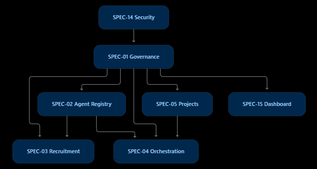
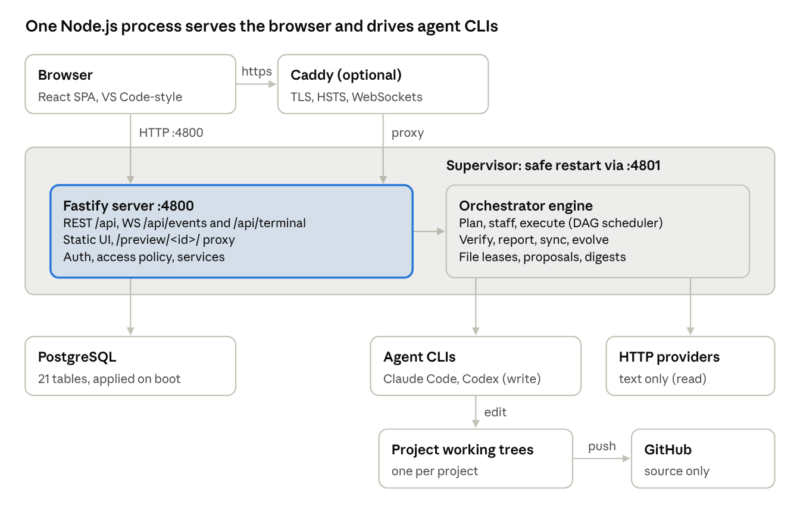

# Requirements from `/home/luca/update/`

Implementable requirements derived from every document in `/home/luca/update/`, written against the
code of 2026-11-04; statuses updated on 2026-11-05 after the safety and pipeline-quality work. `docs/feature-gap.md` is the short status list; these files are the
detail an implementer works from.

## Files

| File | Source document(s) |
| --- | --- |
| [SPEC-01-governance.md](SPEC-01-governance.md) | ASEAO SPEC01.docx |
| [SPEC-02-registry.md](SPEC-02-registry.md) | ASEAO SPEC02.docx |
| [SPEC-03-recruitment.md](SPEC-03-recruitment.md) | ASEAO SPEC.03docx.docx |
| [SPEC-04-orchestration.md](SPEC-04-orchestration.md) | ASEAO SPEC04.docx |
| [ASEAO05-projects.md](ASEAO05-projects.md) | ASEAO05.docx |
| [ASEAO06-research.md](ASEAO06-research.md) | ASEAO06.docx |
| [ASEAO07-analysis.md](ASEAO07-analysis.md) | ASEAO07.docx |
| [ASEAO08-engineering.md](ASEAO08-engineering.md) | ASEAO08.docx, extensions/analysis_results.md |
| [ASEAO09-quality.md](ASEAO09-quality.md) | ASEAO09.docx |
| [ASEAO10-innovation.md](ASEAO10-innovation.md) | ASEAO10.docx |
| [SPEC-11-knowledge.md](SPEC-11-knowledge.md) | SPEC11.docx |
| [SPEC-12-relationships.md](SPEC-12-relationships.md) | SPEC12.docx |
| [SPEC-13-learning.md](SPEC-13-learning.md) | SPEC13.docx |
| [SPEC-14-security.md](SPEC-14-security.md) | SPEC14.docx, ASEAO_SPEC-14_Enterprise_Security_Governance.pdf |
| [SPEC-15-dashboard.md](SPEC-15-dashboard.md) | master specification (.rtf) only |
| [guides-and-other-sources.md](guides-and-other-sources.md) | 1.txt, guides, AgentForge website spec, AWS frameworks guide, 2.pdf |
| [SELF-EVOLUTION.md](SELF-EVOLUTION.md) | `docs/advanced_self_improving_agent_guide.pdf`: verified self-evolution of the platform's own code; IDs `SE-R-nn` |
| [WORKSPACE.md](WORKSPACE.md) | the code of 2026-11-05 (no document): the Workspace and File Manager, specified so they can be set up again on another computer; IDs `WS-R-nn` |
| [images/SOURCES.md](images/SOURCES.md) | which images were kept, which were not, and their sources |

The master specification (`I am trying to download documents related to this.rtf`) gives one
acceptance criterion per spec; each file quotes it at the top.

Not used: `978-3-032-22940-3 (1).pdf` (no extractable text), `AXoR-Design-System-Requirements.pdf`
(another product). The cloned framework repositories are code, not specifications.

## Conventions

- **IDs.** `Sxx-FR-nn` keeps the spec's own functional-requirement number; `Sxx-R-nn` is a
  requirement written here (it cites the spec section); `Sxx-D-nn` is a defect in the current
  code against the spec; `Sxx-G-nn` is gated; `AT-`, `KT-`, `AR-`, `LE-`, `SEC-` refer to the
  spec's acceptance tests.
- **Status.** `done (symbol)` met in code; `partial` part met, the rest in the linked `R`;
  `open` to implement; `gated` waits until more roles are enabled (CLAUDE.md: only the core
  pipeline and research rooms are on until the pipeline is reliable, defined in G-R-04);
  `skip (reason)` deliberately not taken.
- **Stack.** The specs assume PostgreSQL, Neo4j, Qdrant, Redis, NATS, containers and an ABAC
  engine. Requirements here are adapted to this repository (SQLite with one writer, FastAPI,
  plain JS, executors in `data/worktrees/`). Where that is impossible the item is `skip` with a
  reason; nothing is silently rewritten.
- **Acceptance.** Every `R` ends with an acceptance condition that can become a pytest test
  (offline, temp `DATA_DIR`).
- Diagrams that define behaviour are in `images/` and are transcribed in text where used.

## Suggested order

The `.rtf` roadmap builds organisation first; this repository already has the core pipeline, so
the order is safety and correctness of that pipeline first, then management, then expansion.

1. **Safety and correctness now**: done 2026-11-05 — S14-R-01, S14-R-04, S12-D-01, S13-D-01,
   S08-R-03, S08-R-04, S04-R-05 (worktree reconcile), S04-R-06 (deadline cap, re-plan, budget
   pause, escalation of a repeatedly failing check), S14-R-03 (cost rule), S13-D-02 (smoke suite
   before a live trial).
2. **Pipeline quality**: done 2026-11-05 — S04-R-01 blackboard, S04-R-02 decision records,
   S04-R-04 workflow states, S04-R-10 messages, S11-R-01, S11-R-05; partial S11-R-03, S04-R-12.
   S03-R-02 duplicate prevention and G-R-03 failure-mode tests done as well.
   S09-R-01 staged gates and G-R-04 measured enablement gate done too, then G-R-01 contract fields
   and S04-R-03 conflict review. Step 2 is complete.
3. **Management**: ASEAO05 milestones, risks/blockers, insights, action items done 2026-11-05
   (S05-R-01..R-04, S05-R-05 partial); topics (S05-R-07) with G-R-07 done too; SPEC-02 versions and health (S02-R-01, R-02); S14-R-05 classification; S06-R-02 source monitoring; S02-R-03 per-agent concurrency and quotas; SPEC-15 views (Knowledge,
   Security, goal trace, stop level for all users, S15-R-01..R-04) with S11-R-04 contradictions and S11-R-06
   versions. Step 3 is complete. (S14-R-04 incidents was done in step 1.)
4. **Later**: SPEC-13 experiments and learning plans (done 2026-11-05: S13-R-01..R-07); SPEC-12 relationship kinds,
   links of new agents, fair staffing, mentoring and corrections (done 2026-11-05: S12-R-01..R-04, R-06); S11-R-07
   knowledge graph (done 2026-11-05); G-R-05 MCP (done); S12-R-05 shifts with S06-R-05 handovers and S12-R-07 network view (done 2026-11-05).
   G-R-06 A2A (done 2026-11-05). SPEC-14 tool gateway with autonomy levels and isolation recorded per run (S14-R-02,
   S14-R-06; S14-R-07/R-08 partial) and S14-R-09 threat model done 2026-11-05.
   S05-R-06 project registration fields and lifecycle done 2026-11-05.
   S04-R-07 escalation levels, S04-R-08 loop prevention and S04-R-09 budget dimensions done 2026-11-05, then
   S06-R-01 richer research requests and S07-R-03 hypotheses, then S07-R-01 decision reports and S08-R-01
   requirements and traceability. SPEC-03 recruitment done 2026-11-05: S03-R-01 capability gaps, S03-R-03 records
   and job descriptions, S03-R-05 approval policy; S03-R-04 probation (qualification run open).
5. **Still open** (2026-11-05), in a sensible order:
   S03-R-04 qualification run (`qualify_recruits`); S01-R-01..R-05 room
   editing, position history, delegation, organisation export, policy versions; S04-R-11 workflow templates and
   strategies; S05-R-05, S05-R-08, S05-R-09; S11-R-03 and S04-R-12 (partial); S14-R-07 L3 isolation and
   S14-R-08 per-call tool logs (partial); then the gated rooms one at a time (G-R-04).

Reference architecture of AgentForge (the dashboard/engine this project took features from):

*One process serves the browser and drives agent CLIs: browser → (optional Caddy TLS) → server
(REST, WebSockets, static UI, auth) + orchestrator (plan, staff, execute DAG, verify, report,
sync, evolve; file leases, proposals, digests) under a safe-restart supervisor → PostgreSQL,
agent CLIs (Claude Code, Codex) editing project working trees, HTTP model providers (read-only),
GitHub (source-only push).*
