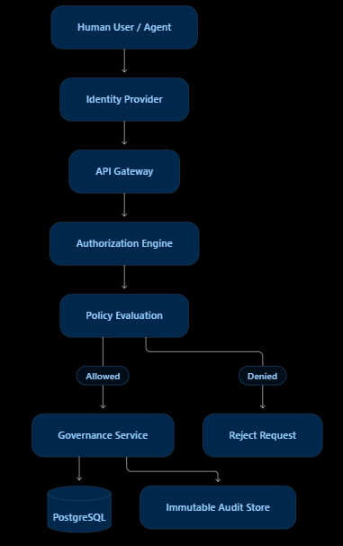
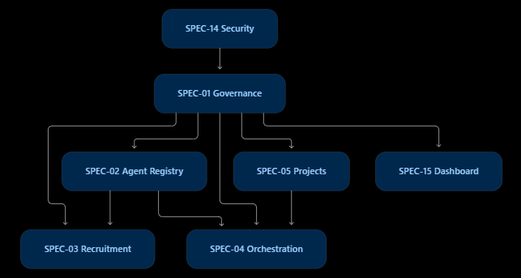

# SPEC-01 — Company governance and organizational structure

Source: `/home/luca/update/ASEAO SPEC01.docx`. Master criterion (`.rtf`): *a manager can create a
department; a department can contain multiple agents; agents can have one primary manager and
multiple project collaborators; unauthorized agents cannot change company-level policies; all
organizational changes are recorded.*

Mapping: organization → the single installation; department → `Room`; position → `Agent.role` +
`Agent.title`; reporting → `Agent.superior_id`; human owner → administrator `User`;
authority → `auth` permissions (users) and `Agent.permissions` (agents); audit →
`governance.audit`.

Authority levels (§4.1, kept for reference): G0 human owner, G1 CEO, G2 executive director,
G3 department director, G4 section manager, G5 specialist. Decision categories (§4.2):
operational, technical, organizational, financial, critical (critical → human owner only).

*Human user / agent → identity provider → API gateway → authorization engine → policy evaluation
→ allowed: governance service → database + immutable audit store; denied: reject request.*

*SPEC-14 security underlies SPEC-01 governance; SPEC-01 feeds SPEC-02 registry, SPEC-05 projects
and SPEC-15 dashboard; SPEC-02 feeds SPEC-03 recruitment and SPEC-04 orchestration.*

## Functional requirements (spec IDs kept)

| ID | Requirement | Pri | Status |
| --- | --- | --- | --- |
| S01-FR-01 | Company registration and configuration | P0 | skip: one organization per installation; settings via `prefs.py` |
| S01-FR-02 | Department management (hierarchy, no cycles, history) | P0 | done (`organization.create_room`, `update_room`, S01-R-01) |
| S01-FR-03 | Executive positions independent of agent identity | P0 | done: roles outlive agents (clones, retirement); room leads and project GMs keep a position history (`position_changes`, S01-R-02) |
| S01-FR-04 | Reporting structure, formal vs project collaboration | P0 | partial: `superior_id` (formal), `relationships` (collaboration) |
| S01-FR-05 | Role and responsibility definitions | P0 | done (`org.ROLES` role specs) |
| S01-FR-06 | Authority and permission management | P0 | partial: user permissions done; agent autonomy → SPEC-14 S14-R-02 |
| S01-FR-07 | Company objectives decomposed to departments | P0 | gated (goals are per project) |
| S01-FR-08 | Department KPIs | P1 | partial: room metrics in `performance.report` |
| S01-FR-09 | Delegation (scope, expiry, revocable) | P0 | done (`policies.delegate`, `allows`, S01-R-03) |
| S01-FR-10 | Decision and approval workflow | P0 | done for goals (SPEC-04 S04-R-02, `decisions.py`); merge approval delegable per project (S01-R-03) |
| S01-FR-11 | Transactional restructuring | P1 | gated |
| S01-FR-12 | Immutable governance audit | P0 | done (`governance.audit`, `verify_audit`) |
| S01-FR-13 | Organizational reports (JSON/CSV) | P1 | done (`organization.export`, `/api/org/export`, S01-R-04) |
| S01-FR-14 | Versioned organizational policies | P0 | done (`policy_versions`, `Project.policy`, S01-R-05) |

## Specific requirements

### S01-R-01 Room editing with history — FR-02 — done
- Administrators can create, rename, enable/disable rooms and set the parent room and the room's
  lead agent; a room cannot be its own ancestor; a room with running goals cannot be disabled.
- Every change is audited with before/after values. Acceptance: a cycle is rejected.
- Done 2026-11-05 in `organization.py`: `POST /api/rooms`, `PATCH /api/rooms/{key}` (audited `room_update` with
  before/after), Agents → Rooms. "Running goals" means an agent of the room has a queued or running task of a goal
  that is not final; the company GM's room cannot be disabled either. A disabled room's agents are not staffed
  (`registry.staff` refuses instead of cloning or recruiting around it, `resolve_role` falls back, discovery skips
  them) and a project cannot add a disabled room (it keeps one it listed). Rooms are never deleted.
  Tests: `tests/test_organization.py`.

### S01-R-02 Position history — FR-03 — done
- When the lead of a room or a project's GM changes, record `(position, previous agent, new
  agent, effective at, reason)` so decisions stay attached to the position.
- Done 2026-11-05: `position_changes` with positions `room:<key>:lead` and `project:<id>:gm` (also when a project is
  created), `organization.positions`, `holder(position, at)`, `GET /api/org/positions`; a project's GM is
  editable (`manager_id`, `manager_reason`) on the project form.

### S01-R-03 Delegation of approval rights — FR-09 — done
- An administrator can delegate a permission (e.g. approve merges for project X) to another user
  with scope (project) and expiry; revocation is immediate for new actions. Audited.
- Agents can never receive delegated approval rights over their own work.
- Done 2026-11-05 in `policies.py` (`delegations` table): the delegable right is `approve_goals` (approve or reject
  the project's goals waiting for a merge), for one project, at most 365 days, to an active non-admin user, never
  for the platform project. `api.goal_approver` checks the grant on each call, so revocation and expiry hold for the
  next action; the delegate sees the project while the grant holds (`projects.visible`) and `/api/auth/me` lists
  the active grants. Grant, revoke and each delegated approval are audited (high). Agents have no user row, so no
  delegation reaches them. Users → Delegate. Tests: `tests/test_policies.py`.

### S01-R-04 Organization export — FR-13 — done
- `GET /api/org/export?format=json|csv`: rooms, agents (role, superior, lifecycle, certification
  level), relationships summary.
- Done 2026-11-05 (admin-only, audited): JSON has all three; CSV is one table, `&table=rooms|agents|relationships`
  (default agents). Agents → Rooms links them.

### S01-R-05 Policy versions — FR-14
- Governance-relevant settings (command policy additions, budgets, approval rules, autonomy
  defaults) are stored with version, author and timestamp; the previous version can be restored.
  A project may add stricter rules but cannot weaken company-wide ones.
- Acceptance: lowering `goal_budget_usd` for one project works; raising it above the company limit
  is rejected.
- Done 2026-11-05: `policy_versions` (scope `company` or `project:<id>`) records the overrides and the values in
  force of `policies.GOVERNANCE_KEYS` (approval, goal budgets, budget action, recruitment approval and
  qualification, proposals, goal depth, candidate smoke, auto push, A2A, and the new `blocked_commands`: company
  command rules on top of the built-in ones) on each `prefs.set_value`/`clear`, with the author; the first change
  records the prior state as version 1. `POST /api/policy/restore` (a new version itself), Settings → Policy
  versions. A project's own rules (`Project.policy`: goal cost/token/agent limits, `require_approval`,
  `recruit_requires_approval`) are refused when weaker; `policies.effective` takes the stricter of both in
  `budgets.limits`, `quality` (needs approval) and `recruitment.needs_approval`, so a company limit lowered later
  still wins. Not taken: per-project command rules (commands run without a project context) and an autonomy
  default (autonomy comes from the role template).
