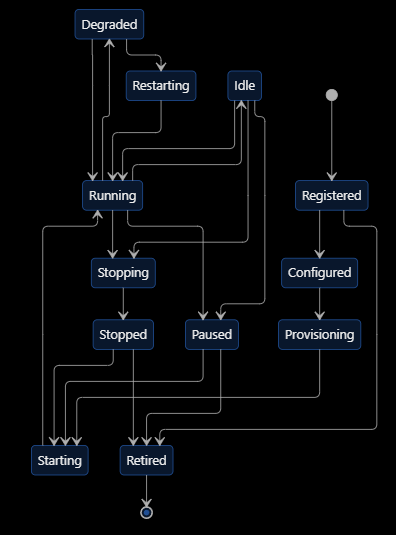

# SPEC-02 — Agent registry and runtime

Source: `/home/luca/update/ASEAO SPEC02.docx`. Master criterion (`.rtf`): *the system can register,
start, assign, monitor, suspend and retire agents without losing their historical project
records.*

Mapping: registry → `registry.py` + `agents` table; runtime instance → one executor run (`Run`)
per task; sessions → `Task.session_id` (Claude Code resume).

Spec states (§6.1): Registered (identity created) → Configured (profile validated) → Provisioning
→ Starting → Running ↔ Idle; Running → Degraded → Restarting → Running; Running/Idle → Paused;
Running → Stopping → Stopped → Starting; Registered, Paused, Stopped, Provisioning → Retired (final).
§6.1 also requires the agent lifecycle and the runtime instance state to be stored separately.

Here: `Agent.lifecycle` (`active|paused|retired`) is the agent state; `Agent.status`
(`idle|busy|disabled`) and `Run` rows are the runtime state. Agents are invoked per task, so
Provisioning/Starting/Stopping collapse into a run's start and end.

## Functional requirements (spec IDs kept)

| ID | Requirement | Pri | Status |
| --- | --- | --- | --- |
| S02-FR-01 | Register an agent with a unique identity | P0 | done (`registry.create_agent`, unique name) |
| S02-FR-02 | Retrieve and search agents | P0 | done (`list_agents`, Agents view) |
| S02-FR-03 | Update profiles | P0 | done (`update_agent`) |
| S02-FR-04 | Version all agent configurations | P0 | done (`agent_versions`, S02-R-01; playbook: `playbook_versions`; definition file: git) |
| S02-FR-05 | Assign an organizational position | P0 | done (`room_key`, `superior_id`) |
| S02-FR-06 | Register skills | P0 | done (`Agent.skills`) |
| S02-FR-07 | Associate an approved model | P0 | done (`model_pref`, routes) |
| S02-FR-08 | Tool permission policies | P0 | done (`Agent.permissions`); gateway → S14-R-06 |
| S02-FR-09 | Create and launch runtime instances | P0 | done (executor run per task) |
| S02-FR-10 | Stop and restart runtimes | P0 | done: per goal (E2), per agent (E1, its processes ended), per room (E4), all (E5) — SPEC-14 S14-R-01 |
| S02-FR-11 | Monitor runtime health | P0 | done (`registry.check_health`, S02-R-02) |
| S02-FR-12 | Manage sessions | P0 | done (`--resume`, `Task.session_id`) |
| S02-FR-13 | Track resource consumption | P1 | done (`usage.py`, `Run`) |
| S02-FR-14 | Temporary agents | P1 | done (clones retired after the goal) |
| S02-FR-15 | Clone from templates | P1 | done (`clone_agent`, role specs) |
| S02-FR-16 | Controlled model replacement | P1 | done (routes, model test) |
| S02-FR-17 | Runtime migration | P2 | skip (single host) |
| S02-FR-18 | Automatic runtime recovery | P1 | partial: goals resume after a restart (SPEC-04 S04-R-05), transient errors are retried (S04-R-06) |
| S02-FR-19 | Retire without deleting history | P0 | done (`set_lifecycle`) |
| S02-FR-20 | Complete lifecycle history | P0 | done (S02-R-01: every lifecycle change, stops and lifts included) |
| S02-FR-21 | Capability discovery | P1 | partial → SPEC-03 S03-R-02 |
| S02-FR-22 | Configuration rollback | P1 | done (`registry.rollback`; playbook `restore`) |
| S02-FR-23 | Detect inactive and unhealthy agents | P1 | done (`registry.health_overview`, S02-R-02) |
| S02-FR-24 | Quotas and concurrency limits | P1 | done (global `max_parallel`; per agent S02-R-03) |

## Specific requirements

### S02-R-01 Versioned agent configuration and lifecycle history — FR-04, FR-20, FR-22
- Table `agent_versions`: `agent_id`, `version`, snapshot of (skills, permissions, model_pref,
  superior_id, room_key, enabled, autonomy, playbook_version), `changed_by`, `reason`, `at`.
  Written by `update_agent`, `set_lifecycle`, `create_agent`, evolution promotions.
- `POST /api/agents/{id}/rollback?version=` restores a snapshot (audited).
- Acceptance: three updates → three versions; rollback restores the first snapshot exactly.
- **Status: done** (`AgentVersion`, `Agent.config_version`; `registry.record_version`, `config_versions`,
  `rollback`, `StaleVersion`; `GET /api/agents/{id}/config-versions`, `POST /api/agents/{id}/rollback?version=`
  (audited, the enablement gate applies when it enables a gated role); agent card → Versions;
  `tests/test_agent_versions.py`). A snapshot holds skills, permissions, model_pref, superior_id, room_key,
  enabled, lifecycle, goal (mission) and plugins. The spec's `autonomy` does not exist here. `playbook_version`
  is left out: the playbook has its own versions and restore (Playbook & history), the definition file its git
  history. Versions are written by `create_agent`, clones and recruits, `update_agent`, `set_lifecycle`,
  E1/E4 stops and their lifting, and clone merges; agents from before get a `baseline` version at start-up. A
  change that alters nothing writes no version. Rollback refuses retired agents and retired targets, and
  re-checks the model (AT-008). AT-023: `PATCH /api/agents/{id}` takes `expected_version`; an older one gets
  409 and changes nothing (the card sends it).

### S02-R-02 Health and inactivity — FR-11, FR-23
- An agent is `degraded` when its last 5 runs include ≥3 executor errors (not gate failures) or
  its model's test fails; degraded agents are skipped by `staff` and an administrator is notified.
- Agents idle more than `inactive_days` (setting, 30) are listed for retirement review; clones
  idle after their goal ends are already retired.
- Acceptance: three executor errors in a row mark the agent degraded and staffing picks another.
- **Status: done** (`Agent.health`, `health_reason`, `health_since`; `registry.check_health` after every
  recorded run (`usage.record`), `recheck_model` after a model test, `reset_health`, `inactive`,
  `health_overview`; `GET /api/agents/health`, `POST /api/agents/{id}/health/reset`; Agents → the
  "degraded · inactive" button, the card's notice; setting `inactive_days`). Errors are executor failures
  (`Run.ok` false) among the last 5 runs, and the latest run must have failed too (an agent whose retry or next
  run succeeds is healthy again); runs ended by a stop or cancel ("terminated by signal") and command-policy
  refusals do not count. Administrators are notified once per degradation.
  The model test counts for the model the agent asks for first (its preference or its role's route), not the
  fallback the router would pick. `staff` skips degraded idle agents and clones instead (a clone starts
  healthy); discovery does not reuse a degraded agent. When every agent of the role is degraded by its model's
  failed test, staffing fails instead (a clone would ask for the same model). A degraded agent stays benched until an administrator
  resets it or its model is changed; both start a new window. Inactive: active original agents other than the
  company GM whose last run (or creation) is older than `inactive_days`; listed only, never retired
  automatically.

### S02-R-04 Spec acceptance tests (§15) still to cover
Tests to add to `tests/` (the rest are met by existing behaviour or tests):
AT-014 unauthorized launch → denied and audited.
Done in `tests/test_agent_versions.py`: AT-004, AT-008, AT-013 (repeated executor errors; agents have no
heartbeat, they run per task), AT-016, AT-019 (paused, then resumed the next day), AT-023.

### S02-R-03 Per-agent concurrency and quotas — FR-24
- `Agent.max_concurrent` (default 1, as today via `busy`) and an optional daily cost quota per
  agent; exceeding it makes the agent unavailable until the next day.
- **Status: done** (`Agent.max_concurrent`, `daily_cost_quota_usd`, `active_goals`; `registry._free`,
  `spent_today`, `over_quota`, `QuotaExceeded`, `release(agent_id, goal_id)`; `loop._out_of_quota`,
  `resume_after_quota` (called by the goal queue's watcher); agent card → Goals at once, Daily cost quota;
  `tests/test_agent_versions.py`). An agent takes up to `max_concurrent` goals at once (1 to 8), never the same
  goal twice (two runs of one agent in one goal would share its Claude Code session); `status` is `busy` while it
  works on any. The quota covers the agent and its clones together (a clone would otherwise bypass it), counts
  `Run.cost` since 00:00 UTC, and staffing neither clones nor reuses an agent past it. AT-019: a task whose role is
  out of quota is skipped, the iteration is not judged, and the goal is paused (`paused_for: quota`); it goes back
  to the queue by itself on the next UTC day, or when an administrator raises the quota and resumes it (a goal
  over its budget by then waits for an administrator as a budget pause). A planner out of quota pauses the goal the
  same way; a research agent out of quota only means no research notes. Both settings are configuration versions.
