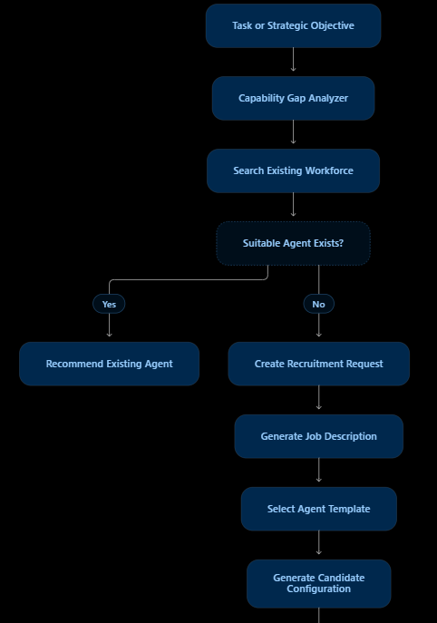
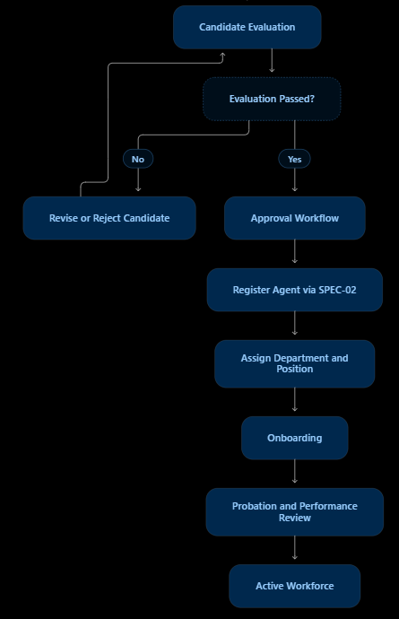
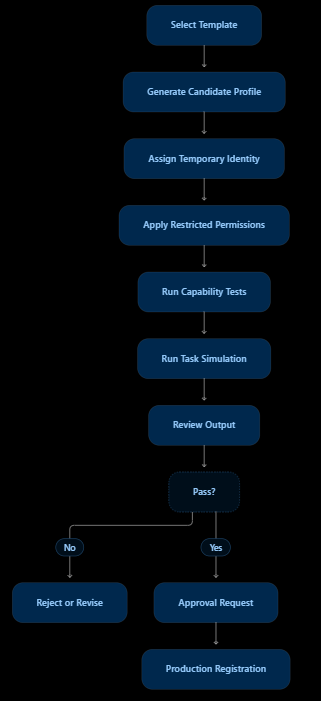
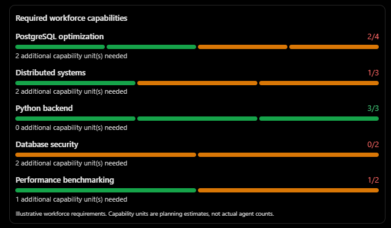

# SPEC-03 — Dynamic agent recruitment and workforce creation

Source: `/home/luca/update/ASEAO SPEC.03docx.docx`. Master criterion (`.rtf`): *a task can trigger
specialist recruitment, qualification and assignment, with a complete audit trail.* The `.rtf`
recruitment rules: every new agent has a specific job description, defined expertise, required
tools, limited permissions, a reporting manager, relevant knowledge, evaluation criteria, a
resource budget and a lifecycle policy. Creating an agent means configuring an instance, not
training a model. `1.txt`: *when assigning a task, a specialized agent is created, and
relationships are established with agents with similar roles to refer to their experience.*

Today (`registry.staff`, 2026-11-05): idle agent of the same role → else clone the best of that role → else,
for a role nobody holds, a recruitment request (`recruitment.py`, table `recruitments`): reuse or clone an
agent covering ≥ 70 % of the skills, or recruit a new specialist from a job description, approved by policy or
by an administrator, then on probation. Planner role names are normalised first (S03-R-02).

*Task or strategic objective → capability gap analyzer → search existing workforce → suitable
agent exists? yes: recommend existing agent; no: recruitment request → job description → select
template → candidate configuration → evaluation.*

*Candidate evaluation → passed? no: revise or reject; yes: approval workflow → register via SPEC-02
→ assign department and position → onboarding → probation and performance review → active
workforce.*

*Select template → generate candidate profile → temporary identity → restricted permissions →
capability tests → task simulation → review output → pass? → approval request → production
registration.*

## Functional requirements (spec IDs kept)

| ID | Requirement | Pri | Status |
| --- | --- | --- | --- |
| S03-FR-01 | Detect missing workforce capabilities | P0 | done: `recruitment.capability_gap`, per project and per staffing decision (S03-R-01) |
| S03-FR-02 | Search existing agents for candidates | P0 | done: any active agent covering ≥ 70 % of the skills (S03-R-02) |
| S03-FR-03 | Create recruitment requests | P0 | done (`recruitment.open_request`) |
| S03-FR-04 | Generate job descriptions | P0 | done: from the role template and the task contract (S03-R-03) |
| S03-FR-05 | Required and preferred skills | P0 | done: required = skills with a gap, preferred = skills the workforce has |
| S03-FR-06 | Select agent templates | P0 | done: the role's `org.ROLES` entry, else the developer/QA template (`Recruitment.template`) |
| S03-FR-07 | Generate candidate profiles | P0 | done (implicit in `_recruit`) |
| S03-FR-08 | Evaluate candidate capabilities | P0 | partial: probation with reviewed tasks; qualification run open → S03-R-04 |
| S03-FR-09 | Run candidate test assignments | P0 | open → S03-R-04 (`qualify_recruits`) |
| S03-FR-10 | Record evaluation evidence | P0 | done: probation passes and failures per recruit, reviews on the gate |
| S03-FR-11 | Approve or reject candidates | P0 | done (`recruitment.approve`/`reject`, Evolution → Recruitment) |
| S03-FR-12 | Register approved candidates | P0 | done |
| S03-FR-13 | Assign room and position | P0 | done (`room_key`, `superior_id`) |
| S03-FR-14 | Onboarding | P0 | partial: similar-agent links → SPEC-12 S12-R-02 |
| S03-FR-15 | Probation periods | P1 | done (`Agent.probation_tasks_left`) |
| S03-FR-16 | Temporary agents | P0 | done (clones retired after the goal) |
| S03-FR-17 | Permanent recruitment | P1 | done (`create_agent`) |
| S03-FR-18 | Forecast workforce requirements | P1 | gated |
| S03-FR-19 | Track recruitment costs | P1 | partial: `Recruitment.evaluation_cost_usd` stays 0 until the qualification run exists |
| S03-FR-20 | Recommend restructuring | P2 | gated |
| S03-FR-21 | Detect duplicate or redundant agents | P1 | done (`registry.duplicates`, Evolution page) |
| S03-FR-22 | Track recruitment effectiveness | P1 | done (`recruitment.effectiveness`, Performance) |
| S03-FR-23 | Recruitment cancellation | P0 | done: a pending record can be rejected or cancelled |
| S03-FR-24 | Preserve recruitment history | P0 | done (agents retained, `events`) |
| S03-FR-25 | Human approval policies | P0 | done (`recruit_requires_approval`, S03-R-05) |

## Specific requirements

### S03-R-01 Capability gap from verified proficiency — §5.2
- Gap for skill s: `G_s = R_s − A_s`, `A_s = Σ_i P_i,s × C_i × V_i,s` (verified proficiency ×
  availability × verification factor). Self-assigned skill levels of new recruits count with
  `V = 0.5` until certified (SPEC-13 S13-R-03); certified skills count `V = 1`.
- Used by `staff` to decide reuse vs clone vs recruit, and shown per project
  (see the example below).
- **Status: done** (`recruitment.capability_gap`). P = skill level / 5, at most 1 (one proficient agent is one
  unit; a recruit claims 5 for each skill of its task); C = the free share of the agent's concurrent slots (0 when
  paused, disabled, degraded or at G0); V = 0.5 for a recruit's skill until a final evaluation certifies it, else 1
  (levels set by an administrator or grown from verified outcomes). Only original agents count, not clones. Per
  project (`/api/projects/{id}/capability_gap`, Projects → Plan): R_s = the number of the project's unfinished tasks
  needing s, at least 1 for each required skill. Each staffing decision records the gap on its task's skills
  (one unit each); the reuse/clone/recruit choice itself stays the S03-R-02 coverage rule.

*Example: PostgreSQL optimisation 2/4 (2 more needed), distributed systems 1/3, Python backend
3/3, database security 0/2, performance benchmarking 1/2. Units are planning estimates.*

### S03-R-02 Discovery and duplicate prevention before recruiting — §6, §11.2
- Before `_recruit`, search all active agents by skill overlap with the task's skills (Jaccard
  over skill keys + role-name similarity via `registry.similarity`). If an agent covers ≥ 70 % of
  the skills, reuse (or clone) it instead of recruiting, and log the reason.
- Planner role names are normalised against existing roles (synonyms: `backend_dev`→`developer`,
  `tester`→`qa`, …) before staffing.
- A periodic check lists agents with near-identical role and skills for consolidation
  (`evolution.consolidate` exists).
- Acceptance: a plan naming `backend_dev` with skills `python, api` staffs an existing developer.
- **Status: done** (`registry.ROLE_SYNONYMS`, `_covering` before `_recruit`, `registry.duplicates()` on the
  Evolution page). Coverage counts skill keys; `registry.similarity` is used for the duplicate list.

### S03-R-03 Recruitment record and job description — §7, §8
- Table `recruitments`: goal, requested role, required/preferred skills, job description
  (generated by the GM: responsibilities, expertise, tools, permissions, reporting manager,
  evaluation criteria, budget, lifecycle `temporary|permanent`), template used, decision
  (`reuse|clone|recruit`) with reason, resulting agent, cost of evaluation.
- The recruit's `goal`/`backstory` come from the job description, not a generic sentence.
- **Status: done** (`recruitment.py`, `recruitments`). One record per goal and role (parallel tasks and later
  iterations share it); also for a reuse or clone of a covering agent. The job description is built from the role
  template and the task contract without a model call (staffing holds a lock); a pending one can be revised, each
  version kept in `history` (AT-005). Evaluation cost stays 0 until the qualification run exists.

### S03-R-04 Qualification and probation — §9, §10
- Probation is a flag on an `active` agent (`Agent.probation_tasks_left`, default 3 for recruits),
  not a new `lifecycle` value — `registry.staff` and `evolution.cycle` select only
  `lifecycle == "active"`, so a separate state would never be staffed.
- A recruited agent starts in probation: its first N=3 tasks are always
  reviewed by QA of a different provider and cannot be the only writer of a goal's final change
  without review; after N passing tasks the probation flag clears, after 2 failures the agent is
  retired and its lessons kept.
- When an eval suite matches the role (e.g. `smoke` for writers), a quick qualification run can
  be required before first use (setting `qualify_recruits`, default off — costs money).
- Recruitment effectiveness = pass rate of recruits during probation, shown in Performance.
- **Status: partial.** Done: recruits start with 3 probation tasks; a clone of a probationer counts for its
  original; the loop adds a QA review (`probation-review`, avoiding the writer's provider) when the iteration has
  none, and the gate fails a probationer's change without a passing review by an agent not on probation (check
  `probation review`). A verified pass counts down; a failure counts only when the recruit's own task failed or a
  review depending on it failed (not when another check failed the gate); 2 retire it, its lessons stay. A retired
  or disabled recruit is not replaced under its old approval: the replacement is a new record under the policy. Effectiveness in Performance. Open: the
  `qualify_recruits` run, because eval suites staff by role (`registry._trainee` only substitutes a trainee within
  its own role), so a recruit of a new role cannot be measured on `smoke` yet.

Spec acceptance tests (§18) this covers: AT-001 gap report (S03-R-01), AT-002 reuse recommended
and AT-017 duplicate warning (S03-R-02), AT-005 versioned job description (S03-R-03),
AT-007 candidate without production access (recruits never get more than the role template),
AT-008..010 failed/passed qualification (S03-R-04), AT-011 unauthorized approval → denied and
audited and AT-022 human suspends recruitment (S03-R-05), AT-015 temporary agent expiry (done:
`retire_goal_clones`), AT-020 repeated approval → no duplicate agent (approval is idempotent per
recruitment record).

### S03-R-05 Human approval policy — FR-25, §16.3
- Setting `recruit_requires_approval` (`never|permanent_only|always`). Approval requests appear as
  notifications; until approved the goal waits (blocker, SPEC-05 S05-R-02).
- Recruits never get more permissions than the role template; `network`/`shell` for a new role
  needs administrator approval.
- **Status: done.** `never` (default) approves every record by policy; `permanent_only` holds a new agent (a clone
  is temporary and goes through); `always` also holds a clone made for a role nobody holds. A held task is skipped
  and the goal pauses (`paused_for = "recruitment"`, a staffing blocker on its project, an admin notification);
  approving registers the agent once (approving again changes nothing, AT-020) and resumes the goal (a
  decision made before the goal paused requeues it right away); rejecting or
  cancelling resumes it and the task fails with the refusal, so the planner re-plans. Only administrators decide; a
  refused attempt is audited (`recruitment_approve_denied`, AT-011). A recruit of a role outside the catalog gets
  the template's permissions without `shell`/`network`; approval grants them (`grant`), also after a policy approval.
  Benchmark goals fail instead of waiting.
