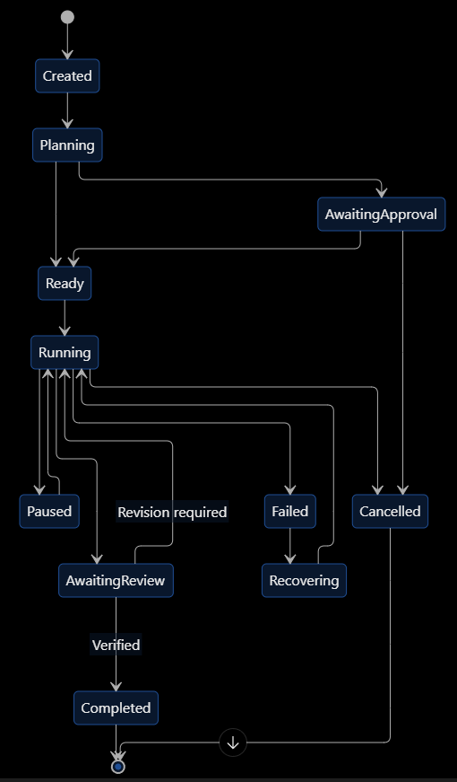
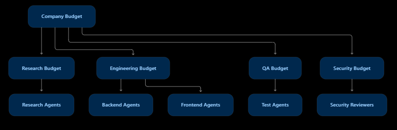
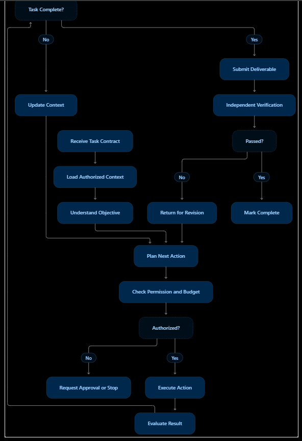
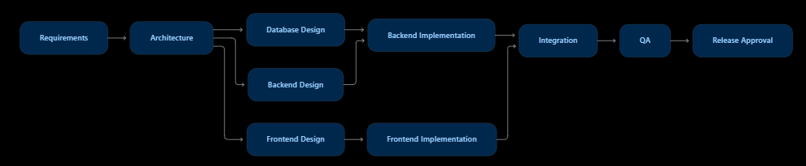
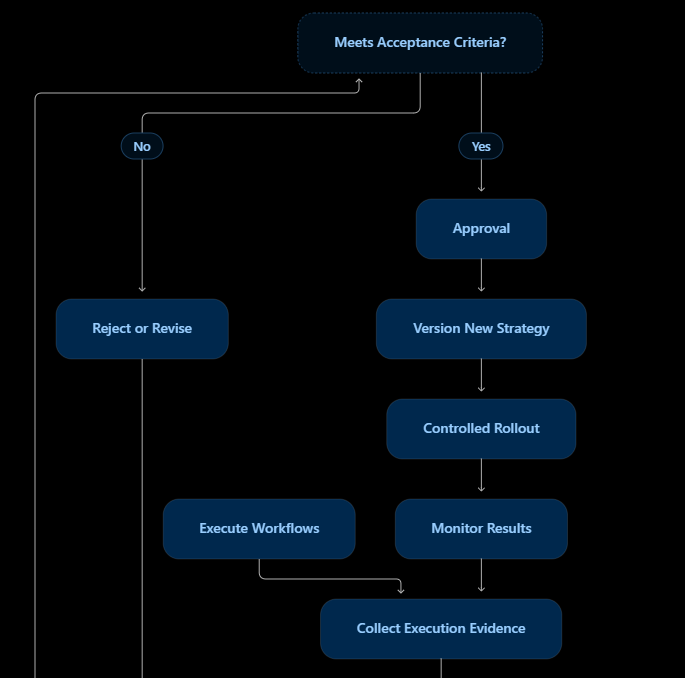

# SPEC-04 — Multi-agent orchestration and collaborative execution

Source: `/home/luca/update/ASEAO SPEC04.docx` (FR table §5, sections §9–§15).
Master criterion (ASEAO master specification, `.rtf`): *a single objective can be decomposed into
multiple dependent and independent tasks, executed by different agents, and assembled into one
verified deliverable.*

Mapping to this codebase: objective → `Goal`; task contract → `contracts.TaskContract`;
orchestrator → `loop.py`; scheduler → `scheduler.run_dag`; team → agents staffed by
`registry.staff`; budgets → `goal_budget_usd` / `goal_time_budget`.

## Functional requirements (spec IDs kept)

| ID | Requirement | Pri | Status |
| --- | --- | --- | --- |
| S04-FR-01 | Receive and register human objectives | P0 | done (`loop.create_goal`) |
| S04-FR-02 | Interpret objectives and constraints | P0 | done (`loop._plan`) |
| S04-FR-03 | Generate orchestration plans | P0 | done (`loop._plan`) |
| S04-FR-04 | Decompose objectives into subtasks | P0 | done (`contracts.validate_plan`) |
| S04-FR-05 | Define task dependencies | P0 | done (`Task.depends_on`, `contracts.topo_order`) |
| S04-FR-06 | Discover suitable agents | P0 | done (`registry.staff`) |
| S04-FR-07 | Dynamically form agent teams | P0 | done (`registry.staff`, `learning.link_team`) |
| S04-FR-08 | Assign and delegate tasks | P0 | done |
| S04-FR-09 | Support hierarchical supervisors | P0 | partial: GM plans, `Agent.superior_id` exists, no supervisor intervention → S04-R-07 |
| S04-FR-10 | Support agent-to-agent communication | P0 | open → S04-R-10 |
| S04-FR-11 | Support parallel execution | P0 | done (`scheduler.run_dag`) |
| S04-FR-12 | Support sequential execution | P0 | done |
| S04-FR-13 | Maintain shared task context | P0 | open → S04-R-01 |
| S04-FR-14 | Track task and team progress | P0 | done (`Task.status`, `/api/stream`) |
| S04-FR-15 | Aggregate agent results | P0 | done (`loop._summary`) |
| S04-FR-16 | Resolve conflicting outputs | P1 | open → S04-R-03 |
| S04-FR-17 | Verify task completion | P0 | done (`contracts.check`, `quality.evaluate`) |
| S04-FR-18 | Retry failed tasks | P0 | partial: iteration retry and escalation model only → S04-R-06 |
| S04-FR-19 | Handle timeouts and cancellations | P0 | done (`loop.cancel`, command timeouts, `goal_time_budget`) |
| S04-FR-20 | Recover interrupted workflows | P1 | partial: `GoalQueue.start` re-queues, iteration restarts from scratch → S04-R-05 |
| S04-FR-21 | Enforce execution budgets | P0 | partial: cost and time only → S04-R-09 |
| S04-FR-22 | Support human approval checkpoints | P0 | done (merge approval) |
| S04-FR-23 | Record orchestration decisions | P0 | partial: events only → S04-R-02 |
| S04-FR-24 | Support strategy selection | P1 | open → S04-R-11 |
| S04-FR-25 | Support dynamic team resizing | P1 | open → S04-R-11 |
| S04-FR-26 | Support workflow templates | P1 | open → S04-R-11 |
| S04-FR-27 | Self-evaluation of orchestration | P2 | open (after SPEC-13 experiments) |
| S04-FR-28 | Recommend improved orchestration strategies | P2 | open (after SPEC-13 experiments) |
| S04-FR-29 | Support multi-project concurrency | P1 | done (`GoalQueue` workers, `Goal.project_id`) |
| S04-FR-30 | Support execution replay and audit | P1 | partial → S04-R-12 |

## Specific requirements

### S04-R-01 Blackboard (shared, versioned goal context) — §10
- New table `blackboard` in `db.py`: `goal_id`, `section`
  (`objective|planning|research|engineering|qa|reports`), `key`, `version`, `author_agent_id`,
  `task_id`, `content`, `sources` (list), `review_status` (`draft|reviewed|rejected`), `created_at`.
  Unique `(goal_id, section, key, version)`.
- Writes use optimistic concurrency: a write names the version it is based on; if a newer version
  exists the write is rejected (no silent overwrite). Old versions are never deleted.
- The planner writes `objective` (goal, constraints, acceptance criteria) and `planning`
  (breakdown, dependencies); research writes findings with source URLs; Developer writes
  technical decisions; QA writes test results and defects.
- Context loading (§10.2): each task prompt gets its contract, the dependencies' outputs, and only
  the sections its role needs (Developer: objective, planning, engineering, relevant decisions;
  QA: objective, engineering, qa). Never the full conversation, never another goal's entries.
- Acceptance: two writes based on the same version → the second is rejected; a Developer prompt
  contains the goal's `engineering` entries and no entries of another goal.

### S04-R-02 Decision records — §12.2, also SPEC-01 FR-10, ASEAO07 §13.1, ASEAO08 §7.2
- New table `decisions`: `goal_id`, `project_id`, `topic`, `alternatives` (list),
  `recommendation`, `reasoning`, `evidence` (blackboard/task/source refs), `assumptions`,
  `confidence` (0–1, labelled an estimate), `category`
  (`operational|technical|organizational|financial|critical`), `requires_human_approval`,
  `status` (`draft→submitted→under_review→approved|rejected`, plus `escalated|expired|cancelled`),
  `approver`, `decided_at`.
- The Architect's plan may emit decisions; a goal with an open `requires_human_approval`
  decision cannot be merged.
- API: `GET /api/decisions?goal_id=`, `POST /api/decisions/{id}/decide` (calls `_audit`).
- Acceptance: a decision marked `requires_human_approval` blocks `loop.approve` until it is approved.

### S04-R-03 Conflict resolution — §12.1
- The orchestrator must never resolve conflicting outputs by taking the last one received.
- Contracts may name a `decision_topic`; when two tasks of one iteration give different
  recommendations on the same topic, the orchestrator schedules a review task (reviewer from a
  different provider, reusing `avoid_provider`). The review compares both against the acceptance
  criteria and produces a decision record (S04-R-02). High-impact (`critical`/`financial`)
  conflicts escalate (S04-R-07).
- Acceptance: two task outputs with different recommendations on one topic → one review task and
  one decision record citing both task IDs.

### S04-R-04 Goal workflow state machine — §13.1

Transitions (from the diagram): `Created→Planning`; `Planning→Ready`;
`Planning→AwaitingApproval`; `AwaitingApproval→Ready`; `AwaitingApproval→Cancelled`;
`Ready→Running`; `Running→Paused`; `Paused→Running`; `Running→AwaitingReview`;
`AwaitingReview→Running` (revision required); `AwaitingReview→Completed` (verified);
`Running→Failed`; `Failed→Recovering`; `Recovering→Running`; `Running→Cancelled`;
`Completed` and `Cancelled` are final.

- Map onto `Goal.status`: `queued`=Created/Ready, add `planning`, `paused`, `recovering`;
  `awaiting_approval`=AwaitingReview; `approved`=Completed. Keep existing values readable.
- New table `goal_transitions` (`goal_id`, `from`, `to`, `reason`, `actor`, `at`); every status
  change goes through one function that rejects transitions not listed above.
- Acceptance: an illegal transition (e.g. `approved→running`) raises; each change writes one row.

### S04-R-05 Durable recovery — §13.2
- On restart, a goal that was `running` resumes from its last checkpoint: tasks already `done` in
  the current iteration are not re-run, `running` tasks go back to `queued`, the worktree is
  reconciled with the last recorded commit (`Goal.history`).
- Non-idempotent operations (merge, push, notifications to external services) record an
  idempotency key `goal:iteration:operation` before running and are skipped if the key is already
  marked complete.
- Resumption re-checks budget and permissions first; history is preserved.
- Acceptance: stop the process after task A of iteration 2 finished → restart → A is not
  executed again and the goal finishes; a merge interrupted after completion is not repeated.

### S04-R-06 Failure-specific retry policy — §14, §14.1

| Failure | Action |
| --- | --- |
| Network error, provider 429/5xx, timeout | retry the task with backoff `d_n = min(d_max, d_0·2^n) + jitter`; then next model in `router.resolve_chain` |
| Invalid task contract | return to planner (re-plan) |
| Executor crash | restart the task once on a fresh session |
| Missing capability | search workforce / recruit (`registry._recruit`) |
| Command blocked by `governance.check_command` | stop the task, notify, no retry |
| Conflicting outputs | review (S04-R-03) |
| Budget exhausted | pause the goal (`paused`), notify, wait for an administrator |
| Same check failing in N consecutive iterations | escalate (S04-R-07) |
| Secret found / scope violation | stop the goal, notify, open an incident (SPEC-14 S14-R-04) |

- Settings (`prefs.py`): `retry_max_attempts` (3), `retry_base_seconds` (2),
  `retry_max_seconds` (60). Every retry has a cap and respects the goal deadline.
- Acceptance: a fake executor raising a transient error twice then succeeding is retried with
  growing delays; a blocked command is not retried.

### S04-R-07 Escalation levels — §14.2
- Levels: 1 assigned agent (retry), 2 goal GM (re-plan), 3 room manager, 4 executive GM of the
  protected platform project, 5 human (notification with approval).
- Escalation depth is chosen by decision category (S04-R-02) and impact, not only by attempt
  count. Each escalation is an `events` row with `level`.
- Acceptance: a `critical` decision escalates directly to level 5.

### S04-R-08 Communication-loop prevention — §9.4
- Maximum proposal/goal chain depth (follow `Goal.parent_goal_id`; setting `max_goal_depth`,
  default 3), extending the existing proposal loop guard.
- Per-task message budget for agent messages (S04-R-10), duplicate-message detection,
  escalation after repeated unanswered requests.
- Acceptance: a proposal from a goal at depth 3 is recorded but not turned into a goal.

### S04-R-09 Budget dimensions and allocation — §15, §15.1

*(Company budget → research / engineering / QA / security budgets → their agents.)*

- Add to goal budgets: model tokens, tool calls / executor turns, number of active agents,
  wall-clock (exists), cost (exists).
- A child goal (from a proposal) cannot exceed its parent's remaining budget; budget increases
  need an administrator and are audited; unused budget returns to the parent.
- Exhaustion pauses or stops according to a setting (`budget_exhausted_action`: `pause|stop`).
- Acceptance: a child goal requesting more than the parent's remainder is capped.

### S04-R-10 Agent-to-agent messages — §9.2, §9.3
- Message contract: `sender_agent_id`, `recipient_agent_id` or `channel`, `goal_id`, `task_id`,
  `kind` (`fact|assumption|recommendation|request|handoff|done`), `body`, artifact references.
  Stored as blackboard entries of section `messages`; recipients see unread messages in their
  next prompt.
- Large content is referenced by artifact or file path, not inlined.
- Acceptance: a `request` from Developer to Architect appears in the Architect's next prompt and
  is linked to the task.

### S04-R-11 Workflow templates, strategy selection, team resizing — FR-24/25/26
- Templates per goal kind (`bugfix`, `feature`, `refactor`, `research`, `docs`) define roles,
  default checks and iteration limits; the planner picks one and records the choice.
- Team resizing: the GM may add an agent of a missing role mid-goal (recruit) or release one.
- Acceptance: a goal created with `kind=research` runs without Developer tasks.

### S04-R-12 Execution trace and replay — FR-30, also SPEC-14 observability
- `GET /api/goals/{id}/trace`: ordered transitions, tasks, runs (agent, model, tool calls,
  duration, cost, errors), decisions, gate results, merges.
- Acceptance: for a finished goal the trace names the agent and model of every run.

## Spec acceptance tests (§23) → requirements

| AT | Test → expected | Covered by |
| --- | --- | --- |
| AT-001..004 | goal → run, invalid goal → errors, plan version, child tasks | done |
| AT-005 | cyclic dependencies → rejected | done (`contracts.topo_order`) |
| AT-006, AT-007 | qualified candidates; unqualified agent → rejected | partial: staffing ranks but never rejects → SPEC-03 S03-R-02 (coverage threshold) |
| AT-008..011 | group recorded; unauthorized member / delegation beyond authority → denied | S14-R-02, S14-R-06 |
| AT-012, AT-013 | parallel and dependent execution | done (`scheduler.run_dag`) |
| AT-014, AT-015 | message delivery recorded; unauthorized context denied | S04-R-10, S04-R-01 |
| AT-016..018 | result stored; failed review → revision; passed → verified | done (gate, iterations); states S04-R-04 |
| AT-019, AT-028 | budget exceeded / exhausted → policy action, pause or stop | S04-R-09, S04-R-06 |
| AT-020 | cancel → pending work cancelled safely | done (`loop.cancel`) |
| AT-021, AT-027 | worker crash / orchestrator restart → resume from durable state | S04-R-05 |
| AT-022 | database unavailable → no false completion | S04-R-05 (status written only after the gate result is stored) |
| AT-023 | duplicate event → no duplicate execution | S04-R-05 (idempotency keys) |
| AT-024 | provider timeout → retry or fallback | S04-R-06 |
| AT-025 | agent unavailable → replacement or escalation | S04-R-07, SPEC-02 S02-R-02 |
| AT-026 | message delivery fails → retry, dead letter | S04-R-10 (messages are DB rows; no broker) |
| AT-029 | approval revoked → protected action blocked | S04-R-02 (decision status checked at merge time) |
| AT-030 | human emergency suspension | SPEC-14 S14-R-01 |
| AT-031..037 | orchestration self-evolution | FR-27/28 via SPEC-13 S13-R-05 |
| §23.4 load tests | 10k agents, 1k events, large graphs | skip for now: establish a measured baseline first (single host) |

## Diagrams kept

*Loop: receive task contract → load authorized context → understand objective → plan next action →
check permission and budget → authorized? (no → request approval or stop) → execute action →
evaluate result → task complete? (no → update context → plan next action; yes → submit deliverable →
independent verification → passed? no → return for revision; yes → mark complete).*

*Requirements → Architecture → Database design / Frontend design / Backend design → implementations
→ Integration → QA → Release approval.*

*Execute workflows → collect evidence → analyse performance → identify bottlenecks → improvement
proposals → evaluate strategy → sandbox experiments → meets acceptance criteria? → approval →
version new strategy → controlled rollout → monitor → back to execution. Implemented through
SPEC-13 (S13-R-05).*
